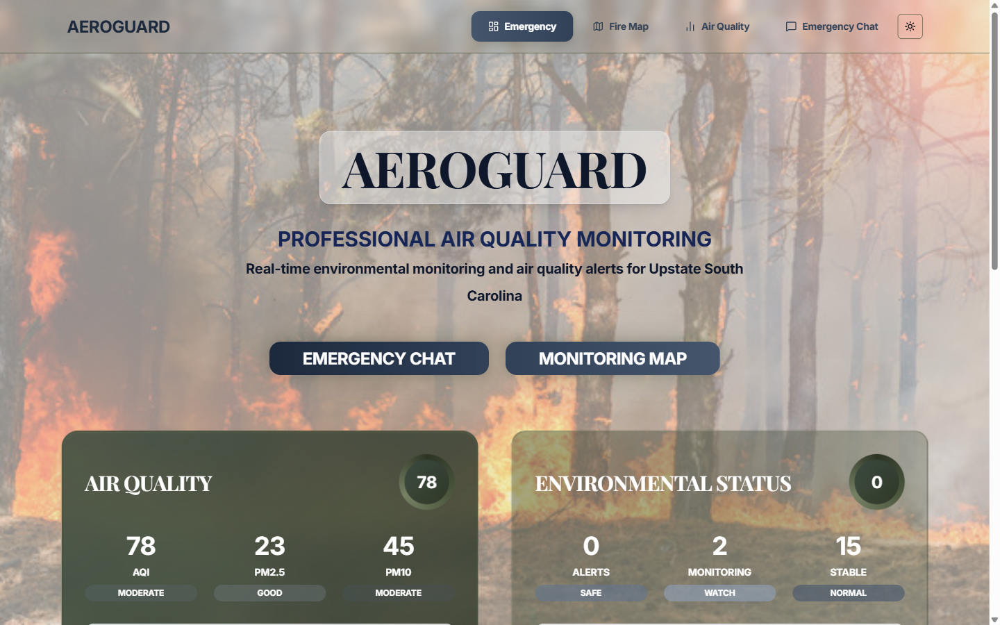
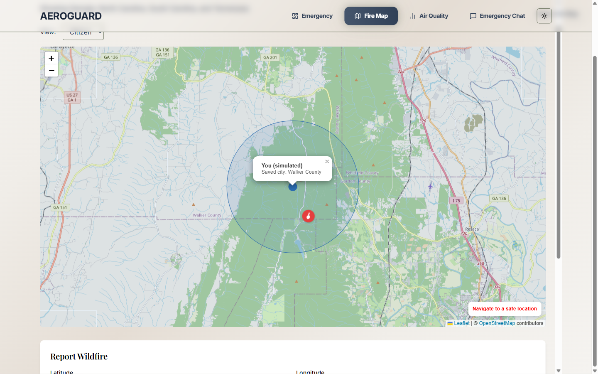
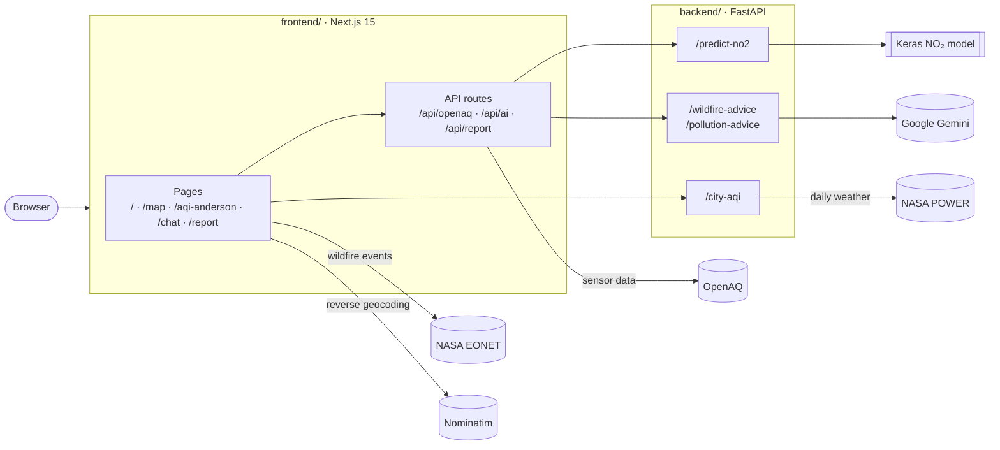

<h1 align="center">AeroGuard</h1>

<p align="center">
  <b>Wildfire and air quality monitoring for the southeastern United States, built on NASA open data.</b>
</p>

<p align="center">
  AeroGuard puts live wildfire events, ground-sensor air quality readings and short-term pollution forecasts in one place, and adds an AI assistant that turns those conditions into plain-language safety advice. It was built in a weekend by a five-person team for the <a href="https://www.spaceappschallenge.org/">NASA Space Apps Challenge 2025</a>.
</p>

<p align="center">
  
  
  
  
  
</p>

<p align="center">
  <a href="#features">Features</a> ·
  <a href="#architecture">Architecture</a> ·
  <a href="#tech-stack">Tech stack</a> ·
  <a href="#getting-started">Getting started</a> ·
  <a href="#project-structure">Project structure</a> ·
  <a href="#data-sources">Data sources</a> ·
  <a href="#known-limitations">Known limitations</a> ·
  <a href="#team">Team</a>
</p>

<p align="center">
  
</p>

<h2 align="center">Features</h2>

<div align="center">

| Feature | Description |
|:---:|:---|
| **Wildfire map** | Active wildfires from NASA EONET plotted over Georgia, North Carolina, South Carolina and Tennessee. A Citizen view shows your position relative to the nearest fire and routes you toward a safe location; an EMS view strips the map down to fires and incoming help requests. |
| **Air quality dashboard** | Time-series charts and summary statistics for OpenAQ ground sensors, drawn with D3. |
| **NO₂ forecast** | A Keras time-series model predicts the next NO₂ reading from the previous ten daily averages. |
| **City AQI forecast** | Next-day AQI estimate for ten South Carolina cities, derived from NASA POWER weather data. |
| **Advice chat** | Gemini-backed assistant with separate wildfire and air quality modes, giving location-specific precautions. |
| **Incident reporting** | Forms for residents to report a wildfire or environmental emergency with coordinates. |

</div>

<p align="center">
  
</p>

<h2 align="center">Architecture</h2>



<p align="center">
  The browser talks to the Next.js app. Next.js API routes hold the OpenAQ key and proxy model and advice requests to the Python service, which owns everything that needs TensorFlow, scikit-learn or Gemini. The notebooks in <code>ml/</code> are where the models were prototyped; they are not part of the request path.
</p>

<h2 align="center">Tech stack</h2>

<div align="center">

| Layer | Technology |
|:---:|:---|
| Web app | Next.js 15 (App Router, Turbopack), React 19, TypeScript |
| UI | Tailwind CSS 4, shadcn/ui, Radix primitives, lucide icons, next-themes |
| Visualisation | Leaflet with OpenStreetMap tiles, D3 |
| API | FastAPI, Uvicorn, Pydantic |
| Machine learning | TensorFlow / Keras, scikit-learn, pandas, NumPy |
| Generative AI | Google Gemini (`gemini-2.5-flash`) |
| Research | Jupyter, earthaccess, xarray, netCDF4 |

</div>

<h2 align="center">Getting started</h2>

<h3 align="center">Prerequisites</h3>

<div align="center">

| Requirement | Details |
|:---:|:---:|
| Node.js | 18.18 or newer |
| Python | 3.11 or newer |
| OpenAQ API key | Free, [register here](https://explore.openaq.org/register) |
| Gemini API key | Free, [create one here](https://aistudio.google.com/apikey) |

</div>

<h3 align="center">1. Clone</h3>

```bash
git clone https://github.com/Rijifl/aeroguard-space-apps.git
cd aeroguard-space-apps
```

<h3 align="center">2. Start the API</h3>

```bash
python -m venv .venv
source .venv/bin/activate        # Windows: .venv\Scripts\activate
pip install -r backend/requirements.txt
uvicorn backend.main:app --reload --port 8000
```

<p align="center">
  Set your Gemini key in <code>backend/main.py</code> first; see the <a href="backend/README.md#gemini-key">API README</a>.
</p>

<h3 align="center">3. Start the web app</h3>

<p align="center">In a second terminal:</p>

```bash
cd frontend
npm install
npm install --no-save leaflet     # see Known limitations
cp ../.env.example .env.local     # then add your OpenAQ key
npm run dev
```

<p align="center">
  Open <a href="http://localhost:3000">http://localhost:3000</a>.
</p>

<p align="center">
  The landing page and the wildfire map work without the API. The forecasts and the advice chat need it running on port 8000.
</p>

<h2 align="center">Project structure</h2>

```
aeroguard-space-apps/
├── frontend/                Next.js web app
│   ├── app/                 Pages and API routes
│   ├── components/          Map, charts, forms, UI primitives
│   └── public/              Static assets and the embedded AQI map
├── backend/                 FastAPI service
│   ├── main.py              All endpoints
│   ├── no2_pred_10_window_newer.keras
│   └── requirements.txt
├── ml/                      Research: not used at runtime
│   ├── notebooks/           Data collection and model experiments
│   ├── models/              Saved experimental models
│   ├── outputs/             Generated global AQI map
│   └── data_extract.py      TEMPO access via earthaccess
├── data/                    TEMPO NO₂ sample and extraction scripts
├── docs/screenshots/
└── .env.example
```

<p align="center">Each directory has its own README with more detail:</p>

<div align="center">

| Directory | What is documented |
|:---:|:---:|
| [`frontend/`](frontend/README.md) | Pages, API routes and components |
| [`backend/`](backend/README.md) | Endpoint reference with request and response examples |
| [`ml/`](ml/README.md) | What each notebook and model file is |
| [`data/`](data/README.md) | Dataset schema and how to regenerate it |

</div>

<h2 align="center">Data sources</h2>

<div align="center">

| Source | Used for |
|:---:|:---:|
| [NASA EONET](https://eonet.gsfc.nasa.gov/) | Live wildfire and natural event locations |
| [NASA POWER](https://power.larc.nasa.gov/) | Daily weather inputs to the city AQI forecast |
| [NASA TEMPO](https://tempo.si.edu/) | Satellite NO₂ columns explored in `data/` and `ml/` |
| [NASA Earthdata CMR](https://cmr.earthdata.nasa.gov/) | Dataset discovery for TEMPO, OMI and SEDAC products |
| [OpenAQ](https://openaq.org/) | Ground-sensor air quality measurements |
| [OpenStreetMap](https://www.openstreetmap.org/) / Nominatim | Map tiles and reverse geocoding |

</div>

<h2 align="center">Known limitations</h2>

<p align="center">
  This is hackathon code, preserved as it was submitted. The functional source is unchanged from the <a href="https://github.com/ben-cuff/space-apps-earth-data">original team repository</a>; this fork reorganises the layout and documentation only. Things a reader should know:
</p>

<div align="center">

| Limitation | Detail |
|:---:|:---|
| **Leaflet is not declared** | It is missing from `frontend/package.json`, so it has to be installed separately as shown above. |
| **`npm run build` does not pass** | The project runs in development mode; type and lint errors block a production build. |
| **The API address is hardcoded** | It is fixed to `http://localhost:8000`, and the Gemini key is a constant in `backend/main.py` rather than an environment variable. |
| **Demo data is simulated in places** | The citizen position is placed at random near a real wildfire, safe-location routing is a straight line rather than a road route, EMS help requests are generated, and the landing page figures are static. |
| **The city AQI is an estimate** | It is derived from weather, not measured, and its model is retrained on each request. |
| **Reports are not stored** | `/api/report` validates and logs a submission, then discards it. |
| **`/report` fails on first server render** | It reads `window` during SSR, and the landing page links to a `/global` page that does not exist. The inline report form on `/map` works. |

</div>

<h2 align="center">Team</h2>

<p align="center">Built at NASA Space Apps Challenge 2025 by:</p>

<div align="center">

| Contributor | Focus |
|:---:|:---:|
| [Ben Cuff](https://github.com/ben-cuff) | Web app foundation, air quality dashboard, OpenAQ integration, FastAPI service |
| [Ahmet Dokmeci](https://github.com/Rijifl) | Forecasting models, satellite data extraction, ML notebooks |
| [Nimra Nayyar](https://github.com/nimnay) | Gemini integration, navigation, incident reporting |
| [Angie Diaz](https://github.com/apa0) | Wildfire map, Citizen and EMS views, safe-location routing |
| [nhun1214](https://github.com/nhun1214) | Contributor |

</div>

<h2 align="center">License</h2>

<p align="center">No license has been published for this project. All rights remain with the contributors.</p>
